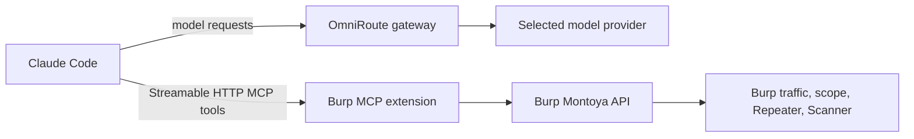

# Burp MCP Server

**Live interception upgrade:** see [Live interception, OpenCode workflow and tool reference](docs/LIVE_INTERCEPTION.md). The existing endpoint remains `http://127.0.0.1:9876/mcp`. New live capture and edit permissions default to off. See [original tool inventory](docs/ORIGINAL_TOOLS.md) and [OpenCode configuration example](opencode.json.example).

The compatibility baseline and runtime fallbacks for Burp Suite Professional 2024.1 are documented in [Burp 2024.1 compatibility](docs/BURP_2024_1_COMPATIBILITY.md). The loaded extension's version and build ID are returned by `burp_get_status` and `burp_get_capabilities`; MCP initialization reports the same build identity.

For Codex MCP configuration, bearer-token recovery, and local request/interception verification, see [Codex connection and verification](docs/CODEX_SETUP.md).

The Burp tab's five-section layout, responsive controls, and UI verification notes are in [Burp MCP UI layout](docs/UI_LAYOUT.md).

A Burp Suite extension that exposes Burp traffic and approved testing actions as Model Context Protocol tools over Streamable HTTP. It builds on PortSwigger's official [Burp MCP Server](https://github.com/PortSwigger/mcp-server) and uses the official Montoya API and Kotlin MCP SDK.



OmniRoute is the model gateway in this setup. Its own MCP server exposes OmniRoute management and routing tools; it does not aggregate arbitrary upstream MCP servers. The OmniRoute upstream MCP aggregation request remains closed as not planned, so Claude Code connects separately to the Burp endpoint while `omniroute launch` supplies Claude Code's model API. See the [OmniRoute Claude Code configuration](https://github.com/cheaper-inference/OmniRoute/wiki/Claude-Code-Configuration) and the [upstream aggregation issue](https://github.com/diegosouzapw/OmniRoute/issues/6364).

## Requirements

- Burp Suite with Montoya extension support. Burp Community supports the traffic and analysis tools; Scanner and Collaborator remain Professional-only.
- Java 17 or later to build. The extension bytecode targets Java 17.
- Windows 10/11 and PowerShell 5.1+ for the scripts below.
- For the model client: Node.js supported by your installed OmniRoute release, OmniRoute, and Claude Code CLI.

## Build on Windows

From PowerShell in the repository directory:

```powershell
.\build.ps1
```

The script runs the automated tests and packages the extension. The output is `build\libs\burp-mcp-all.jar`. To run the underlying Gradle tasks directly:

```powershell
.\gradlew.bat clean test shadowJar
```

No IDE is required. The wrapper downloads the pinned Gradle distribution. The extension JAR is shaded and self-contained. It exposes Streamable HTTP for MCP clients; the outdated Java 21 SSE-to-stdio proxy is not included in this build.

## Install and start the Burp extension

1. Launch Burp Suite.
2. Open **Extensions → Installed → Add**; select **Java**, then choose `build\libs\burp-mcp-all.jar`.
3. Open the new **Burp MCP** suite tab. The server starts automatically by default; use the **Enabled** toggle to stop or restart it.
4. Keep the default host `127.0.0.1` and port `9876`. The endpoint shown in the tab is `http://127.0.0.1:9876/mcp`.
5. Copy the bearer token from **Server Configuration**. Authentication is enabled by default.
6. In Burp, add the intended test hosts to **Target → Scope**. Add the same hosts to **Authorized HTTP Host Allowlist** in the extension tab. History and request tools only return or act on targets that pass both checks.

The extension tab shows connection state, the endpoint, the registered Burp tool names, and the latest 100 payload-free MCP activity events. The MCP SDK does not expose connected client identity to this server.

## Configure OmniRoute and Claude Code

Install and start OmniRoute using its [official quick start](https://github.com/cheaper-inference/OmniRoute/blob/release/v3.8.53/docs/getting-started/QUICK-START.md). On Windows, the documented npm flow is:

```powershell
npm install -g omniroute
omniroute
```

Open the dashboard at `http://localhost:20128`, connect a model provider, and confirm it is available. In a second PowerShell window, use Claude Code with OmniRoute as the model API:

```powershell
omniroute launch
```

For Claude Code to also discover Burp's MCP tools, copy `.mcp.json.example` to `.mcp.json` in the project where you run Claude Code, then provide the Burp token in the same PowerShell session before launching:

```powershell
Copy-Item .mcp.json.example .mcp.json
$env:BURP_MCP_TOKEN = Read-Host "Paste the Burp MCP bearer token"
omniroute launch
```

The example uses `${BURP_MCP_TOKEN}` for Claude Code's supported environment expansion. Keep the token out of Git and unset it when finished:

```powershell
Remove-Item Env:BURP_MCP_TOKEN
```

Alternatively, add the endpoint to Claude Code's local user configuration with its supported HTTP MCP command (the header is saved in Claude Code's local config):

```powershell
$env:BURP_MCP_TOKEN = Read-Host "Paste the Burp MCP bearer token"
claude mcp add --transport http burp-mcp http://127.0.0.1:9876/mcp --header "Authorization: Bearer $env:BURP_MCP_TOKEN"
Remove-Item Env:BURP_MCP_TOKEN
```

Then start the model-routed client with `omniroute launch`. Check the MCP connection with:

```powershell
claude mcp get burp-mcp
claude mcp list
```

Inside Claude Code, `/mcp` shows connected servers. Ask it to call `burp_get_capabilities` or `burp_get_status`; those tools do not make network requests. The `.mcp.json.example` template uses the regular Claude Code HTTP MCP fields `type`, `url`, and `headers`.

## Harmless local request check

1. Start the local test server in one PowerShell window:

   ```powershell
   .\scripts\local-test-server.ps1
   ```

   It listens only on `127.0.0.1:8000`. Stop it with Ctrl+C.

2. In Burp's **Target → Scope**, add `http://127.0.0.1:8000`. Add `127.0.0.1:8000` to the Burp MCP authorized-host allowlist.
3. In **Burp MCP**, turn off **Read-only mode** for this request only. Keep **Require bearer token** enabled.
4. In Claude Code, ask it to send this exact request using `burp_send_http_request`, and review Burp's one-time approval dialog before approving:

   ```http
   GET / HTTP/1.1
   Host: 127.0.0.1:8000
   Connection: close
   ```

   Use host `127.0.0.1`, port `8000`, and `https: false`. The expected response body is `Burp MCP local test endpoint`.

5. Turn **Read-only mode** back on, stop the test server, and disable the extension server when finished.

## Tools and capability limits

The extension exposes connection/project status; filtered Proxy history and Site Map; request and response retrieval and summaries; response comparisons; request modification proposals; Repeater insertion; HTTP/1 and HTTP/2 send tools; heuristic header, cookie, CORS, authentication, and sensitive-data analysis; and bounded security reports.

- `burp_send_http_request`, `burp_send_to_repeater`, and `burp_start_scan` require read-only mode off, an explicit host allowlist match, Burp scope membership, a rate-limit slot, and a fresh user approval. `burp_start_scan` launches a passive audit for one submitted request only. Active checks are disabled because the available Montoya API exposes only legacy active checks, which may include intrusive tests. Repeater insertion does not send the request; the user must click **Send** in Burp. No dedicated credential-attack or brute-force tools, Intruder automation, or unrestricted scan tool is exposed.
- Scanner findings and scan controls report an explicit unsupported-capability error in Community Edition. The current Montoya API cannot enumerate existing Repeater tabs, so `burp_get_repeater_tabs` reports unsupported rather than returning fabricated data.
- HTTP output is bounded, binary bodies are omitted, credentials are redacted, and captured content is marked untrusted. Security-analysis observations are heuristic; suspicious patterns are not labeled confirmed vulnerabilities.
- HTTP requests have a 10-second response timeout and MCP-triggered network actions are limited to 30 per minute.
- The listener binds to loopback by default. If you deliberately bind to a non-loopback address, bearer authentication must remain enabled. Use a firewall and do not expose the port to untrusted networks.

## Tests and real Burp verification

`.\gradlew.bat test` runs automated mock-backed tests and local MCP transport integration tests, including initialization, tool listing, input validation, permission checks, redaction, and parsing. The tests do not connect to a live Burp instance. A live Burp verification is the local-request procedure above; do not treat mock test success as proof of compatibility with every Burp release or edition.

## References

- [PortSwigger Burp MCP Server](https://github.com/PortSwigger/mcp-server)
- [Montoya API documentation](https://portswigger.github.io/burp-extensions-montoya-api/)
- [Kotlin MCP SDK](https://github.com/modelcontextprotocol/kotlin-sdk)
- [Claude Code MCP setup](https://code.claude.com/docs/en/mcp)
- [OmniRoute quick start](https://github.com/cheaper-inference/OmniRoute/blob/release/v3.8.53/docs/getting-started/QUICK-START.md)
- [OmniRoute Claude Code model routing](https://github.com/cheaper-inference/OmniRoute/wiki/Claude-Code-Configuration)
